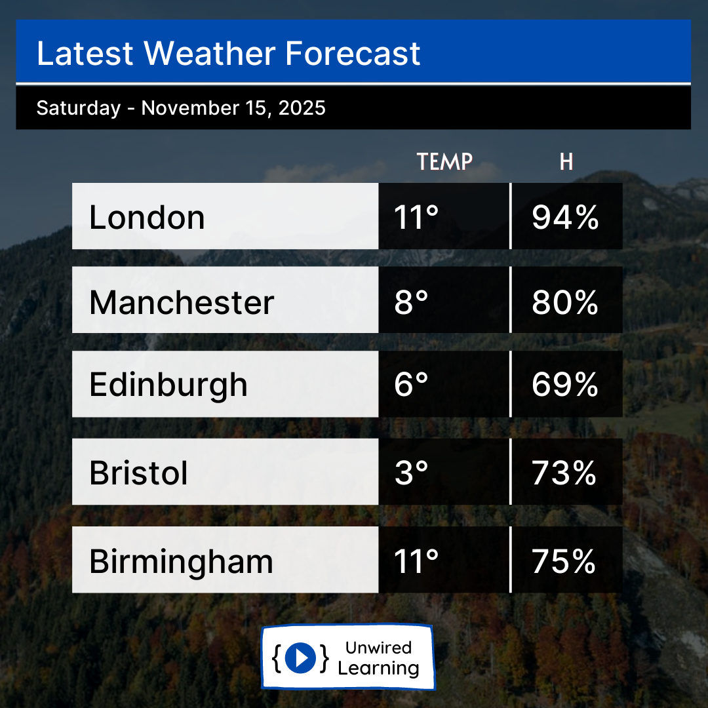

# Weather Report Generator

A Python script that retrieves current weather conditions from OpenWeatherMap for a configured set of cities and renders one image and PDF report per region.



## Features

- Requests current temperature and humidity for 15 configured cities across the UK, India, and the United States.
- Renders the results onto a supplied image template using Pillow.
- Exports PNG and PDF versions of each regional report.
- Reads the API key from an environment variable or a local `.env` file.

## Requirements

- Python 3.9 or later
- An OpenWeatherMap API key with access to the Current Weather API
- The packages listed in [`requirements.txt`](requirements.txt)

## Setup

From this directory, create and activate a virtual environment, then install the dependencies:

```powershell
py -m venv .venv
.\.venv\Scripts\Activate.ps1
python -m pip install -r requirements.txt
```

Create a `.env` file in the project directory:

```dotenv
OPENWEATHER_API_KEY=replace_with_your_api_key
```

Alternatively, set `OPENWEATHER_API_KEY` in your shell environment. Keep the key private and do not commit `.env`.

The script expects `post.png` and `Inter.ttf` in the project directory. Both are included in this repository.

## Run

```bash
python wapi.py
```

Run the command from any working directory. The script locates its assets and saves reports alongside `wapi.py`. File names are prefixed with the run date and include the first city in each configured group, for example `<YYYY-MM-DD>London.png` or `<YYYY-MM-DD>Jaipur.pdf`. Generated reports are ignored by Git.

## Configuration

Edit the city lists and layout positions in [`wapi.py`](wapi.py) to change the report contents. The current implementation uses today's weather conditions; it does not request a multi-day forecast.

## Project files

- `wapi.py` - API requests and report generation
- `post.png`, `Inter.ttf` - Report background and font
- `samples/` - Example PNG and PDF output
- `requirements.txt` - Python dependencies

## Limitations

The script depends on network access and a valid API key. If a city request fails, that city is skipped; a region's reports are still saved if at least one city succeeds, and the process exits with a non-zero status if any region is incomplete. Check the console output and rerun to fill gaps.

## Tests

The test suite uses mocked API responses and does not require an API key or internet access:

```bash
python -m unittest discover -s tests -v
```

GitHub Actions runs this suite on pushes and pull requests.

## License

See [`LICENSE`](LICENSE).
